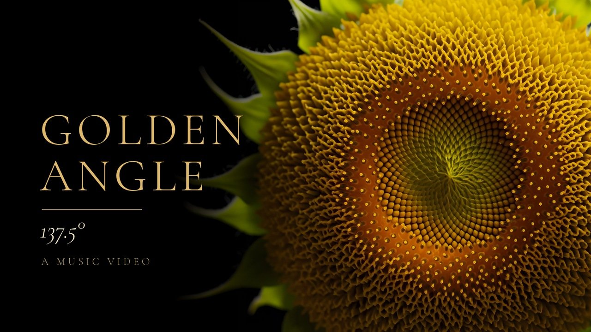
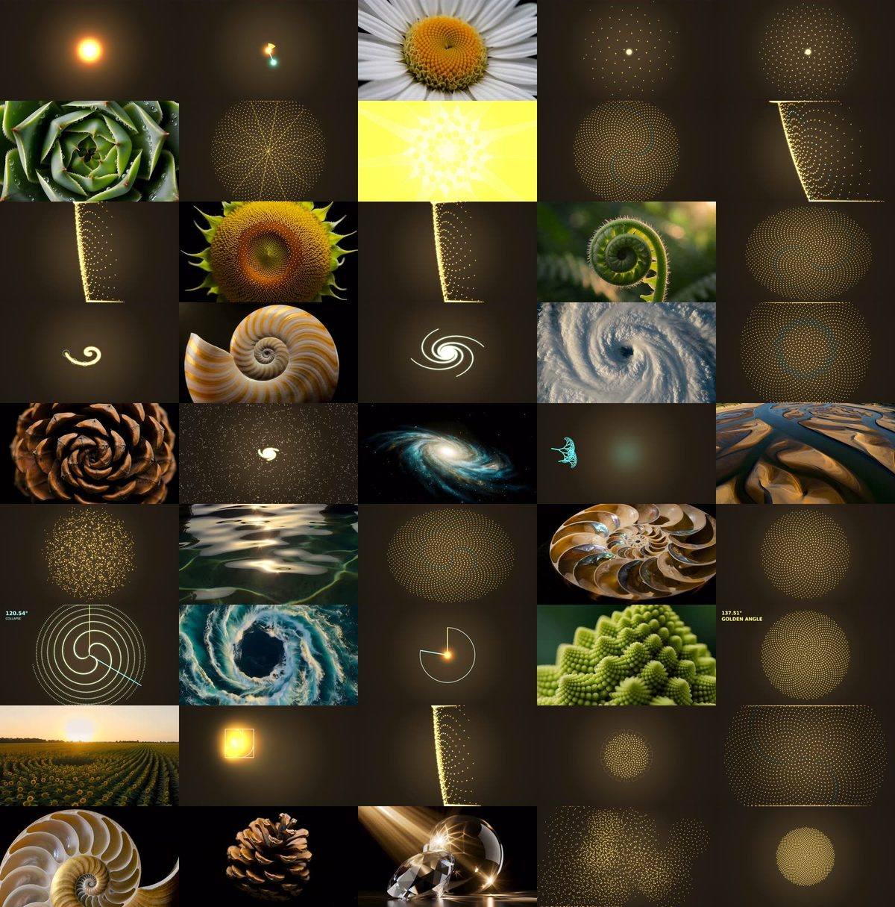

# The Golden Angle



**A 5-minute 4K math music video.** No cast. The subject is one rule: turn by **137.5°**, drop a seed, repeat. Seed → sunflower → shell, storm, pinecone, galaxy → a whole field, then back to one seed.

> The angle that never lines up is the reason it all fits.

**Maintainers / voice:** [@littletechbird](https://x.com/littletechbird) · a Grok Bot craft desk

Video/audio binaries are **not** in this repo (too large). This pack is the forever guide: the math, the dials, the shot list, the render code that drew every math shot, the lessons, and the plan.

**Free forever.**

---

## Watch

| What | Link |
|------|------|
| **YouTube long-form (4K)** | https://youtu.be/I56hSR_EGWQ · https://www.youtube.com/watch?v=I56hSR_EGWQ |
| **X post** | TBD (lands when the post goes live) |
| Channel | https://www.youtube.com/@littletechbird |

---

## What shipped

| Item | Value |
|------|-------|
| Title | **The Golden Angle \| 4K** |
| Song | *Golden Angle* (Suno custom, lyrics-first) · 5:18.67 · ≈103 BPM · audio untouched |
| Picture | **MIX**: 28 code-rendered math shots (native 4K) + 17 photoreal nature shots (2K text-to-video → Real-ESRGAN 4K) |
| Master | 3840×2160 · 24 fps · H.264 · 5:16.6 · 45 unique shots, each used once |
| Rules on screen | Only the bridge angle readout (`137.51°` · `DRIFT` · `COLLAPSE`) |
| Captions | 39 lyric cues, forced-aligned to the vocal stem — [`captions/`](captions/the-golden-angle-lyrics.en.srt) |
| Lip sync | None. There are no faces. The song carries the words. |



---

## The formula in one screen

```
φ            = (1 + √5) / 2                 ≈ 1.6180339887
golden angle = 360° · (1 − 1/φ) = 360°/φ²    ≈ 137.5077640500°

seed n:  θₙ = n · 137.5077°      rₙ = c · √n          (Vogel 1979)

34 · 137.5077° = 13 turns − 4.74°   → 34 arms curl one way
55 · 137.5077° = 21 turns + 2.93°   → 55 arms curl the other
                                    "Thirty-four one way, fifty-five the other"

120° = 360°/3  → 3 straight spokes, gaps everywhere   (the bridge COLLAPSE)
```

Picture math that kept the cut honest:

```
G_plan  = ceil(1.5 × G_old) = ceil(1.5 × 28) = 42     unique real-motion clips banked before assembly
stretch = pocket / source ≤ 1.45                       else FATAL (no slow-mo padding)
motion  ≥ 1.5 mean luma Δ (320×180, 3 frame pairs)     else FATAL (near-still)
reuse   = 0                                            any repeat shot is FATAL
```

Full derivations: [`FORMULAS.md`](FORMULAS.md).

---

## Pipeline (one line)

**thesis → Suno (lyrics-first) → sung lyric map → dials → phase-1 test triad → LOOK → nature wave → code bank (native 4K) → Real-ESRGAN → guarded assembly → LOOK → captions → thumbnail → ship**

Full detail: [`PROCESS.md`](PROCESS.md)

---

## Docs (TOC)

| Doc | What |
|-----|------|
| [`THESIS.md`](THESIS.md) | One rule, no cast, and the energy arc |
| [`FORMULAS.md`](FORMULAS.md) | Golden angle, phyllotaxis, Fibonacci arms, collapse math, G_plan, guards, grade, caption timing |
| [`DIALS.md`](DIALS.md) | The 12 locked dials + render constants |
| [`PROCESS.md`](PROCESS.md) | The pipeline, phase by phase |
| [`PLANNING.md`](PLANNING.md) | How it was planned: craft pack, unique-motion bank, phase gates, v1 → v2 |
| [`SHOTLIST.md`](SHOTLIST.md) | All 45 shots with timecodes, section, source |
| [`LYRIC_MAP.md`](LYRIC_MAP.md) | Song structure + sung lines locked to the take |
| [`lyrics.md`](lyrics.md) | Locked lyrics |
| [`CRAFT_LAWS.md`](CRAFT_LAWS.md) | Hard locks and kill criteria |
| [`LESSONS.md`](LESSONS.md) | What broke, what fixed it, and thoughts for the next one |
| [`BURN_SHEET.md`](BURN_SHEET.md) | Honest cost / time crumbs |
| [`code/`](code/) | Render + assembly source (Python, numpy, ffmpeg) |
| [`captions/`](captions/the-golden-angle-lyrics.en.srt) | Lyric captions (SRT) |
| [`LINKS.md`](LINKS.md) | Watch, sister guides, tools |
| [`PUBLISH.md`](PUBLISH.md) | How this repo was created |
| [`LICENSE`](LICENSE) | MIT |

---

## Sister guides

| Pack | URL |
|------|-----|
| **Birth of Bird** | https://github.com/littletechbird/birth-of-bird-amv |
| **Tesla Flywheel** | https://github.com/littletechbird/tesla-flywheel-amv |
| **Equals in the Room** | https://github.com/littletechbird/equals-in-the-room-amv |
| **The One True Fairy Tale** | https://github.com/littletechbird/the-one-true-fairy-tale-amv |
| **The AMV Queen** | https://github.com/littletechbird/the-amv-queen-amv |
| **You** | https://github.com/littletechbird/you-amv |

The earlier packs taught: chip-away, unique forward motion only, no freeze pads, no Ken Burns, Real LOOK before Done, `G_plan` headroom. The Golden Angle applies that playbook to a cut with **no characters at all**, where half the camera is code.

---

## Hard locks (public)

- **One rule on screen** — every shot shows the golden angle at work, in math or in nature
- **No stills, no Ken Burns, no freeze/tpad, no reuse** — the assembler exits on any of them
- **Code plates render at native 4K** — never upscaled
- **Nature plates upscale with Real-ESRGAN** — never plain bicubic/lanczos (a lanczos master is labeled PROVISIONAL automatically)
- **Captions follow the sung take** — not a remembered paste
- No secrets, API keys, emails, phones, or street addresses live in this repo

---

## Credits (high level)

| Role | Who / what |
|------|------------|
| Creative peer | Human at the local device ([@littletechbird](https://x.com/littletechbird)) |
| Bot lead / craft desk | Grok Bot |
| Song | **Suno** (custom, lyrics-first) |
| Math plates | Python · numpy · scipy · Pillow → ffmpeg (this repo, [`code/`](code/)) |
| Nature plates | **Higgsfield** · MiniMax text-to-video (2K) |
| Upscale | **Real-ESRGAN** on a local GPU |
| Edit / assemble | **ffmpeg** (hard cuts, guarded) |
| Captions | Demucs · stable-ts (faster-whisper large-v3) · MMS forced alignment |
| Math credit | **Helmut Vogel** (1979 sunflower model) · the Fibonacci / phyllotaxis tradition |

---

## License

Documentation and code in this repository are released under the **MIT License**. See [`LICENSE`](LICENSE).
